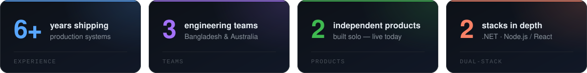
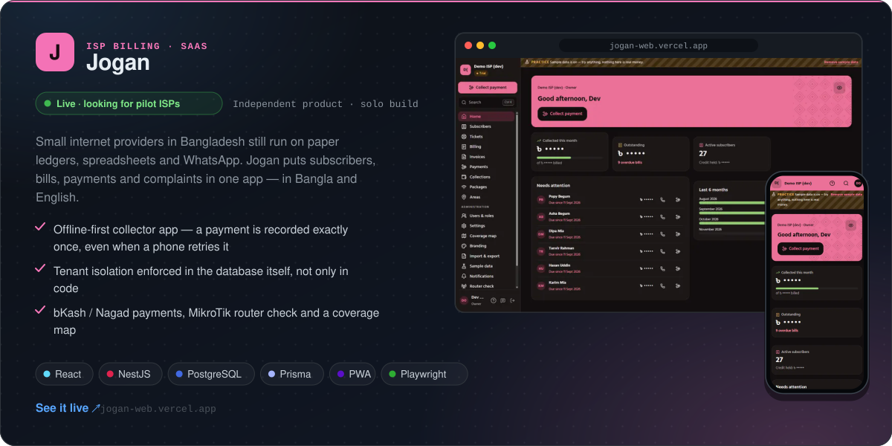
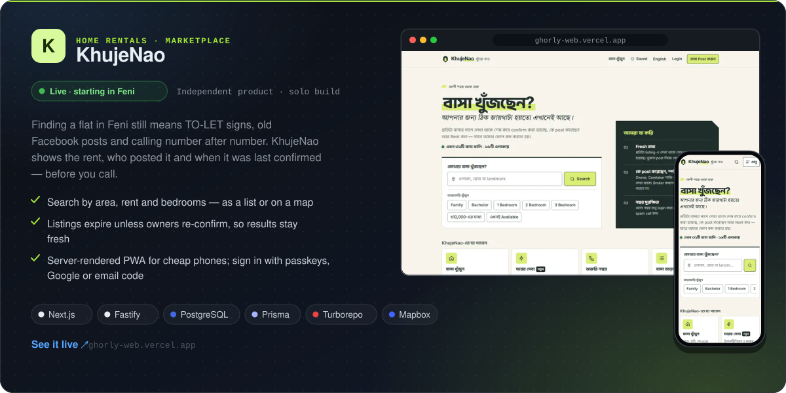
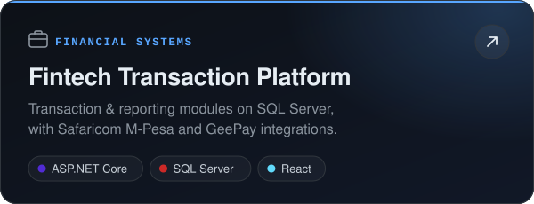
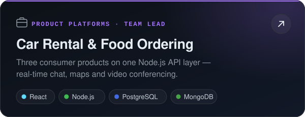
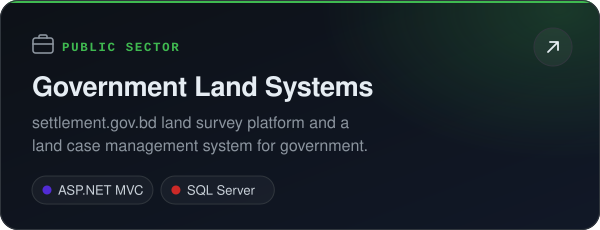
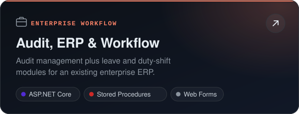
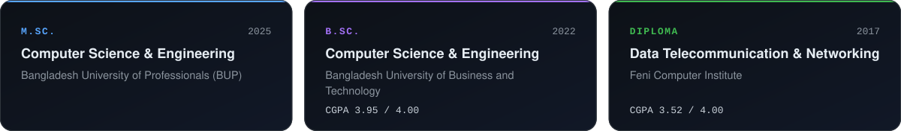

<!-- ═══════════════════════════════════════════════════════════════ -->
<!--                  MARUF HOSSAIN — GitHub Profile               -->
<!--   Artwork in /assets is generated by scripts/build-assets.mjs  -->
<!--   Facts mirror the CV at https://marufh1.github.io/resume/     -->
<!-- ═══════════════════════════════════════════════════════════════ -->

  

    

 

## 👨‍💻 About Me

I'm a full-stack software engineer with **6+ years** of building production web applications end to end, from database schema and API design to the interfaces people use. I work in two ecosystems: **ASP.NET Core, C# and SQL Server** for fintech, government and enterprise systems, and **React, Node.js, TypeScript and MongoDB/PostgreSQL** for full-stack products.

Today I'm building a fintech platform at **Grapes Technology**, with mobile-money integrations and SQL Server performance work. Before that, I led full-stack product development at **Siara Solutions** (Australia). I care about performance, maintainable architecture, and systems that hold up under real load.

## 💼 Experience

## 🚀 Independent Products

Two products I built on my own time after seeing the same problems around me in Bangladesh. I took both from an idea to a live app.

## 🏗️ Selected Work

Case studies from production systems I've built for employers and clients. Full write-ups are on my [portfolio](https://marufh1.github.io/#work).

  
  
  
  

## 🧰 Tech Stack

## 📊 GitHub Activity

  
  

  <picture>
    <source media="(prefers-color-scheme: dark)" srcset="https://raw.githubusercontent.com/marufh1/marufh1/output/github-snake-dark.svg" />
    
  </picture>

<b>📈 Contribution graph</b>

 

## 🎓 Education

 

  

&nbsp;&nbsp;&nbsp;&nbsp;

