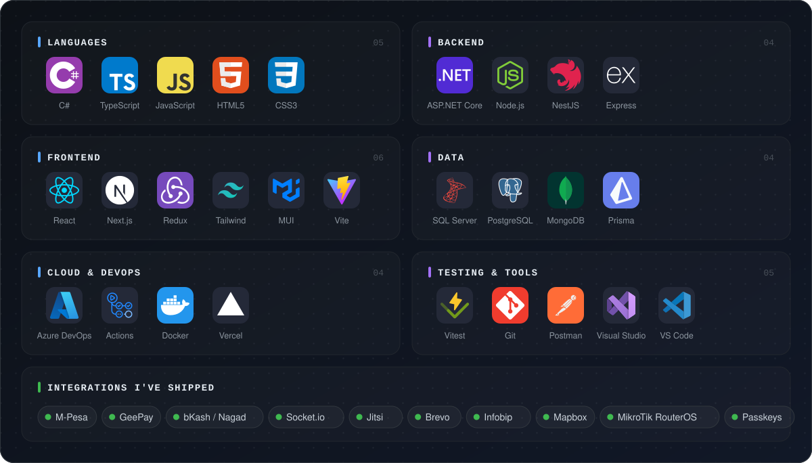
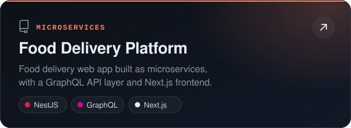
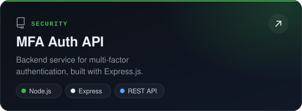
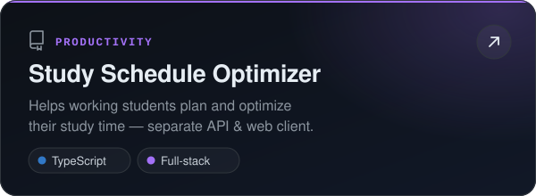
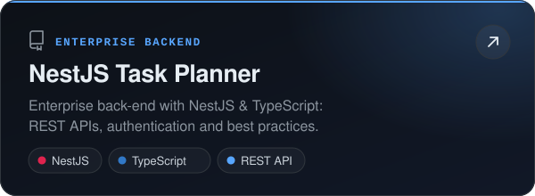
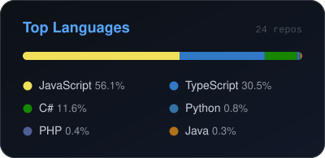

<!-- ═══════════════════════════════════════════════════════════════ -->
<!--                  MARUF HOSSAIN — GitHub Profile               -->
<!--   Artwork in /assets is generated by scripts/build-assets.mjs  -->
<!-- ═══════════════════════════════════════════════════════════════ -->

<div align="center">



<br/><br/>

<a href="https://linkedin.com/in/maruf-h"></a> <a href="mailto:maruf.mhb@gmail.com"></a> <a href="https://marufh1.github.io/"></a> <a href="https://github.com/marufh1"></a>

</div>

<br/>

## 👨‍💻 About Me

I'm a software engineer at **Grapes Technology Ltd.** in **Dhaka, Bangladesh**. I build backend-heavy web applications, from **REST and GraphQL APIs** to **enterprise systems** on **ASP.NET Core** and the **MERN stack**. I care about clean architecture, fast queries, and code that's easy to change.

```yaml
role:       Software Engineer @ Grapes Technology Ltd.
stacks:     [MERN, NestJS, Next.js, ASP.NET Core Web API, SQL Server]
strengths:
  - Backend architecture & system design
  - REST / GraphQL API development
  - Authentication & authorization (JWT, MFA)
  - SQL performance tuning & stored procedures
currently:
  - Building  → Enterprise-grade production systems
  - Learning  → Cloud-native development, Docker & Azure CI/CD
  - Exploring → Clean Architecture, CQRS & microservices
```

## 🧰 Tech Stack



## 🚀 Featured Projects

<p align="center">
  <a href="https://github.com/marufh1/delivery-food-app"></a>
  <a href="https://github.com/marufh1/mfa-api-express"></a>
  <a href="https://github.com/marufh1/study-schedule-optimizer"></a>
  <a href="https://github.com/marufh1/nestjs-task-planner"></a>
</p>

<p align="right"><a href="https://github.com/marufh1?tab=repositories"><b>Explore all repositories →</b></a></p>

## 📊 GitHub Activity

<p align="center">
  <a href="https://github.com/marufh1"></a>
  <a href="https://github.com/marufh1?tab=repositories"></a>
</p>

<p align="center">
  <picture>
    <source media="(prefers-color-scheme: dark)" srcset="https://raw.githubusercontent.com/marufh1/marufh1/output/github-snake-dark.svg" />
    
  </picture>
</p>

<details>
<summary><b>📈 Contribution graph</b></summary>
<br/>
<a href="https://github.com/marufh1"></a>
</details>

<br/>

<div align="center">

<a href="https://linkedin.com/in/maruf-h"></a>&nbsp;&nbsp;<a href="mailto:maruf.mhb@gmail.com"></a>

<br/><br/>



</div>
